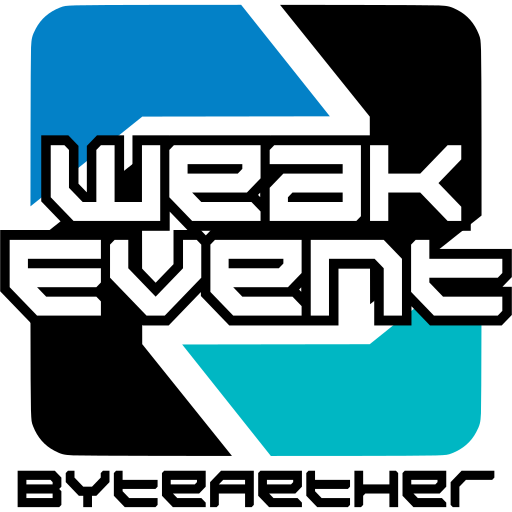

# 

[](https://github.com/ByteAether/WeakEvent/blob/main/LICENSE)
[](https://www.nuget.org/packages/ByteAether.WeakEvent/)
[](https://www.nuget.org/packages/ByteAether.WeakEvent/)
[](https://github.com/ByteAether/WeakEvent/actions/workflows/build-and-test.yml)
[](https://github.com/ByteAether/WeakEvent/actions/workflows/codeql.yml)

Weakly referenced event subscribers. Keep your .NET events lean and memory-safe.

## Introduction



WeakEvent is a .NET implementation of the weak event pattern for applications that publish notifications to objects
whose lifetimes may not be controlled by the publisher. A normal event holds references to its subscribers, so an object
that is no longer in use can remain in memory until it explicitly unsubscribes. This becomes a source of memory leaks or
stale component state when subscriptions outlive their owner.

WeakEvent breaks that reference cycle by retaining instance handlers weakly. When the subscriber object is no longer
used elsewhere, the garbage collector can reclaim it even while a subscription remains registered. Static handlers
remain alive for the lifetime of the event source. No unsubscription is required, although handlers can still be removed
explicitly. Dead subscriptions are ignored and cleaned up during publication.

The library supports synchronous and asynchronous handlers, notifications with or without payload data, and
cancellation-aware publishing. It fits event-driven applications where publishers are long-lived and subscribers are
short-lived or repeatedly created, such as UI components, services that observe background processes, desktop
applications, and Blazor components. It is especially useful when component disposal and other lifecycle boundaries make
manual unsubscription difficult or easy to miss.

For background on the pattern, see Microsoft's documentation
on [WPF weak event patterns](https://learn.microsoft.com/en-us/dotnet/desktop/wpf/events/weak-event-patterns?view=netdesktop-9.0)
and [.NET weak references](https://learn.microsoft.com/en-us/dotnet/standard/garbage-collection/weak-references).

## Features


- **Weak References:** Subscribers are held weakly so they can be garbage-collected when no longer in use.
- **Events With or Without Payloads:** Use `WeakEvent` for notifications or `WeakEvent<TEvent>` to pass event data.
- **Synchronous and Asynchronous Handlers:** Subscribe with `Action`, `Func<Task>`, or a cancellation-aware async
  delegate.
- **Automatic Cleanup:** Dead subscribers are removed during publication.
- **Simple API:** Methods for subscribing, unsubscribing, and publishing.

### Publication behavior

- Subscribers are invoked sequentially in subscription order.
- Publication uses a subscriber snapshot captured when it starts. Subscribing or unsubscribing during publication
  affects later publications, not the current one.
- Cancellation is checked before publication starts and before each subscriber is invoked. Cancellation-aware handlers
  receive the token passed to `PublishAsync`.
- Static handlers remain alive for the lifetime of the event source. Instance handlers, including capturing lambdas, are
  held weakly and do not need explicit unsubscription to become collectible.
- Synchronous handler exceptions propagate unchanged. Asynchronous handler exceptions propagate after the returned task
  is awaited.
- Each invocation in a multicast delegate is subscribed independently and can be unsubscribed as a group.

## Installation

Install the package via NuGet:

```sh
dotnet add package ByteAether.WeakEvent
```

Use the `--version` option to specify
a [preview version](https://www.nuget.org/packages/ByteAether.WeakEvent/absoluteLatest) to install.

## Usage

### Using the `WeakEvent`

```csharp
using ByteAether.WeakEvent;

// Create an event without payload data.
var myEvent = new WeakEvent();

// Create and subscribe a handler.
var subscriber = () => Console.WriteLine("Event received!");
myEvent.Subscribe(subscriber);

// Publish the event.
await myEvent.PublishAsync();
```

### Using the `WeakEvent<TEvent>`

```csharp
using ByteAether.WeakEvent;

// Create an event with payload data.
var myEvent = new WeakEvent<MyEventData>();

// Create and subscribe a handler.
var subscriber = (MyEventData data) => Console.WriteLine("Received: " + data.Message);
myEvent.Subscribe(subscriber);

// Publish the event.
await myEvent.PublishAsync(new MyEventData("Hello, World!"));

// Define your event data
public record MyEventData(string Message);
```

## API

### `WeakEvent`

* `SubscriberCount`\
  Number of live subscribers currently registered.
* `Subscribe(Action handler)`\
  `Subscribe(Func<Task> handler)`\
  `Subscribe(Func<CancellationToken, Task> handler)`\
  Subscribes the handler. Each invocation in a multicast delegate is subscribed independently. Live handlers are invoked
  when the event is published.
* `Unsubscribe(Action handler)`\
  `Unsubscribe(Func<Task> handler)`\
  `Unsubscribe(Func<CancellationToken, Task> handler)`\
  Unsubscribes the handler and returns whether at least one matching invocation was removed. A multicast delegate
  unsubscribes all matching invocations.
* `PublishAsync(CancellationToken cancellationToken = default)`\
  Invokes live subscribers sequentially and removes dead subscribers.

### `WeakEvent<TEvent>`

* `SubscriberCount`\
  Number of live subscribers currently registered.
* `Subscribe(Action<TEvent> handler)`\
  `Subscribe(Func<TEvent, Task> handler)`\
  `Subscribe(Func<TEvent, CancellationToken, Task> handler)`\
  Subscribes the handler. Each invocation in a multicast delegate is subscribed independently. Live handlers are invoked
  when the event is published.
* `Unsubscribe(Action<TEvent> handler)`\
  `Unsubscribe(Func<TEvent, Task> handler)`\
  `Unsubscribe(Func<TEvent, CancellationToken, Task> handler)`\
  Unsubscribes the handler and returns whether at least one matching invocation was removed. A multicast delegate
  unsubscribes all matching invocations.
* `PublishAsync(TEvent eventData, CancellationToken cancellationToken = default)`\
  Invokes live subscribers sequentially with `eventData` and removes dead subscribers.

## Contributing

We welcome all contributions! You can:

* **Open a Pull Request:** Fork the repository, create a branch, make your changes, and submit a pull request to the
  `main` branch.
* **Report Issues:** Found a bug or have a suggestion? [Open an issue](https://github.com/ByteAether/WeakEvent/issues)
  with details.

Thank you for helping improve the project!

## License

This project is licensed under the MIT License. See the [LICENSE](LICENSE) file for details.